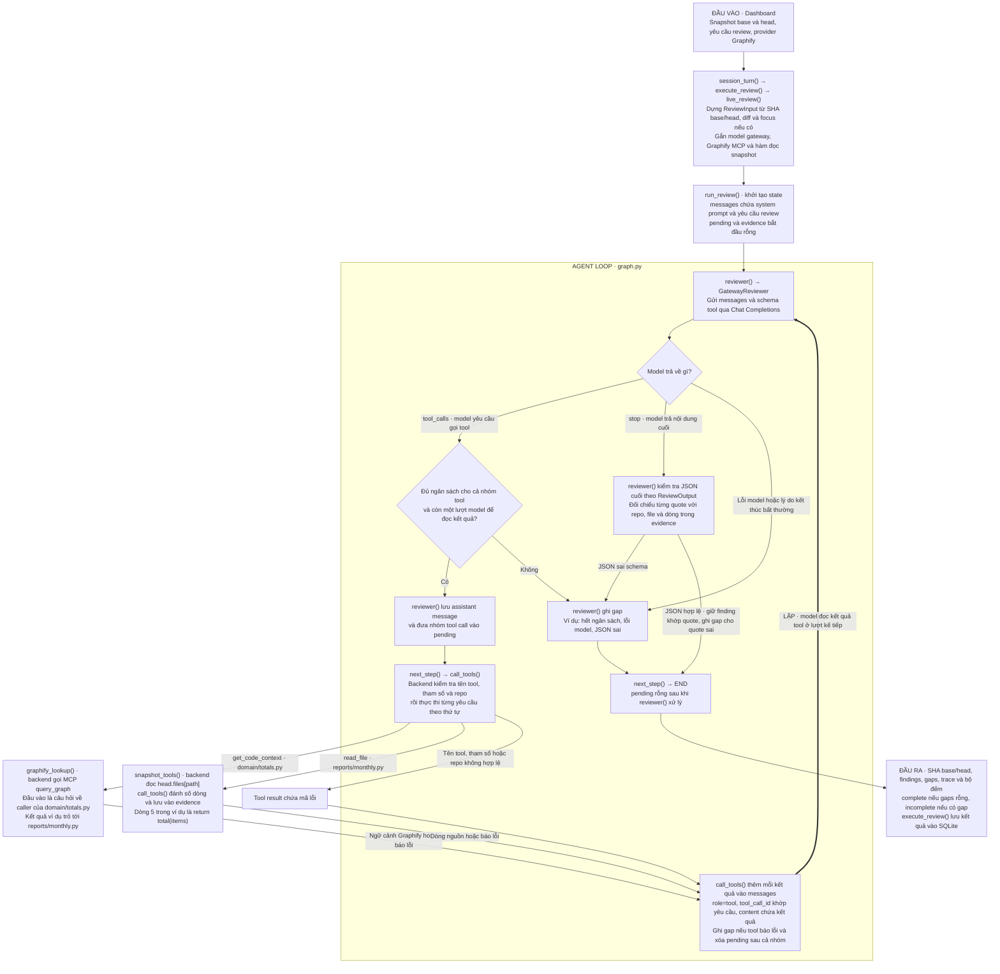
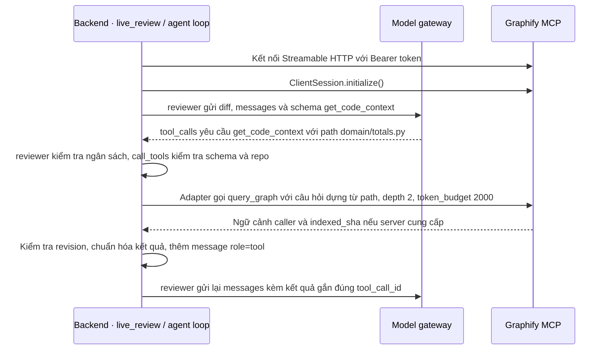
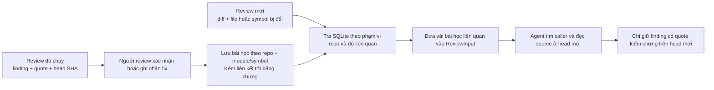

# Agent loop với Graphify

Ví dụ xuyên suốt là một thay đổi chữ ký hàm trong `domain/totals.py`. Diff đổi `total(items)` thành `total(items, fee)`. File `reports/monthly.py` nằm ngoài diff và vẫn gọi `total(items)`. Agent cần tìm caller, đọc source ở snapshot head, rồi báo lỗi kèm dòng trích dẫn.

Tình huống lấy từ demo của repo. Sơ đồ minh họa cách tình huống đó đi qua provider Graphify thật. Demo dùng model và tool giả lập, với cùng vòng lặp `run_review()`. [Diff mẫu](demo.py#L10) · [Điểm vào demo](demo.py#L57)

## Sơ đồ luồng

## Đọc một lượt từ đầu đến cuối

| Lượt model | Đầu vào của model | Model trả về | Backend thực thi và trả về |
| --- | --- | --- | --- |
| 1 | Prompt, SHA base/head và diff đổi chữ ký hàm | `get_code_context({"path":"domain/totals.py"})` | `call_tools()` gọi `repository.lookup(path)`. Adapter Graphify gửi câu hỏi về caller, dependency và định nghĩa tới MCP tool `query_graph`. Kết quả ví dụ trỏ tới `reports/monthly.py`. |
| 2 | Hội thoại trước đó và kết quả Graphify | `read_file({"path":"reports/monthly.py"})` | `call_tools()` gọi hàm đọc từ `head.files`. Nó trả các dòng có đánh số cho model và lưu dòng 5, `return total(items)`, vào `evidence`. |
| 3 | Hội thoại trước đó và các dòng source vừa đọc | JSON có finding tại `reports/monthly.py:5`, với quote `return total(items)` và nhận định caller thiếu đối số `fee` | `reviewer()` kiểm tra quote ở đúng dòng đã đọc, giữ finding và gắn SHA head. Với `gaps` rỗng, kết quả là `complete`, với 3 lượt model và 2 tool call. |

`get_code_context` là tên tool trong schema gửi cho model. `query_graph` là tên tool trên Graphify MCP server. `call_tools()` nối hai bên qua adapter `graphify_lookup()`. Nếu chọn CodeLens, cùng yêu cầu `get_code_context` đi qua HTTP `POST /context/`. `read_file` dùng snapshot head với cả hai provider. [Graphify MCP](dashboard_providers.py#L134) · [CodeLens HTTP](dashboard_providers.py#L91) · [Đọc snapshot](dashboard_providers.py#L192)

## Các hàm cần mở khi đọc code

1. [`session_turn()`](dashboard.py#L498) và [`execute_review()`](dashboard.py#L420) lấy snapshot và provider của phiên, dựng đầu vào, gọi adapter và lưu kết quả từng lượt.
2. [`live_review()`](dashboard_providers.py#L239) gắn model gateway và các hàm thực thi tool vào [`run_review()`](graph.py#L128). Core khởi tạo `messages`, `pending`, `evidence` và bộ đếm cho mỗi lượt review.
3. [`reviewer()`](graph.py#L158) gọi model. Khi có yêu cầu tool, node kiểm tra ngân sách và cập nhật `pending`. Khi model trả nội dung cuối, node kiểm tra JSON và quote. Phép kiểm quote xác nhận trích dẫn xuất hiện ở đúng nơi đã đọc. Nhận định lỗi trong `claim` do model suy luận từ diff và source.
4. [`call_tools()`](graph.py#L197) lấy yêu cầu từ `pending`, gọi hàm tương ứng và thêm kết quả vào `messages` với đúng `tool_call_id`. Chỉ `read_file` ghi vào `evidence`, theo khóa `(repository, path)` và số dòng.
5. [`next_step()`](graph.py#L253) chọn `call_tools` hoặc `END` sau `reviewer()` dựa vào `pending`. Cạnh từ `call_tools` về `reviewer` luôn đưa model trở lại với hội thoại đã có thêm kết quả.

Mặc định mỗi review có tối đa 6 lượt model và 8 tool call. Nếu nhóm tool vượt ngân sách hoặc lượt model vừa dùng là lượt cuối, core ghi `review_budget_exhausted` trước khi chạy cả nhóm. Có gap thì kết quả là `incomplete`, kể cả khi vẫn có finding qua kiểm tra quote. [Ngân sách](graph.py#L128) · [Kết quả cuối](graph.py#L292)

## Đối chiếu với demo

Sau khi [cài package](README.md#L5), chạy `review-agent demo`. Trong `trace`, thứ tự dự kiến là `reviewer → get_code_context → reviewer → read_file → reviewer`. [Model giả lập](demo.py#L35) chọn bước tiếp theo dựa vào số message `role=tool` đã nhận. [Test demo](tests/test_core.py#L11) kiểm tra thứ tự tool, số lượt model và finding ở file ngoài diff.

## Kết nối Graphify MCP và kiểm soát lời gọi

### Backend mở phiên MCP thế nào

1. **Chọn endpoint theo snapshot.** Ở chế độ thủ công, backend dùng URL và token Graphify đã cấu hình. Với Pilot tự động, `PilotIndexer.review_settings()` tìm index của snapshot head theo tài khoản đang dùng. Khi index sẵn sàng và token còn hạn, hàm trả URL `<origin>/mcp/<remote_id>`, token và SHA kỳ vọng. Nếu token sắp hết hạn, backend xếp việc làm mới token và lượt hiện tại nhận gap. [Chọn kết nối](dashboard_graphify.py#L41) · [Điều phối review](dashboard.py#L466)
2. **Mở transport và khởi tạo phiên.** `_graphify_session()` tạo HTTP client với Bearer token, mở Streamable HTTP, tạo `ClientSession` rồi gọi `await session.initialize()`. `graphify_lookup()` dùng blocking portal để loop đồng bộ gọi được phiên MCP bất đồng bộ. Kết nối chính được mở trước `run_review()`, trừ nhánh phát hiện SHA cấu hình sai ngay từ đầu. Kết nối của repo liên quan được mở khi lookup lần đầu. `ExitStack` đóng các kết nối khi lượt review kết thúc. [Khởi tạo phiên MCP](dashboard_providers.py#L124) · [Repo liên quan](dashboard_providers.py#L223) · [Vòng đời adapter](dashboard_providers.py#L239)
3. **Gọi đúng tool và trả kết quả về loop.** Khi model yêu cầu `get_code_context`, core kiểm tra đối số rồi gọi `lookup(path)`. Adapter gọi `session.call_tool('query_graph', ...)` với tên tool cố định. Nội dung trả về được chuẩn hóa, kiểm tra SHA và chuyển thành tool message của agent. `tool_call_id` trên message này là ID của yêu cầu do model trả về. [Thực thi lookup](graph.py#L202) · [Lời gọi MCP](dashboard_providers.py#L140) · [Ghép kết quả với yêu cầu](graph.py#L236)

### Mỗi bên kiểm soát được gì

| Điểm kiểm soát | Hành vi hiện tại |
| --- | --- |
| Tool nào được gọi | Model chọn trong schema agent cung cấp. Backend tự kiểm tra tên tool, từ chối tham số dư và chỉ định tuyến tới repo trong phạm vi review. Adapter Graphify cố định tên `query_graph`, câu hỏi theo mẫu, `depth=2` và `token_budget=2000`. Model chỉ cung cấp path và có thể chọn repo đã được ghim. |
| Chi phí và thời gian | Mặc định core cho tối đa 6 lượt model và 8 tool call tính chung. HTTP client và MCP read có timeout 20 giây được cấu hình riêng. Adapter cắt nội dung context ở 8.000 ký tự. `token_budget=2000` là tham số gửi cho Graphify, còn 8.000 ký tự là giới hạn áp dụng tại backend. |
| Index thuộc revision nào | Nếu có `indexed_sha` trong phản hồi, adapter ưu tiên giá trị đó. Nếu thiếu, adapter có thể dùng SHA cấu hình hoặc SHA được ghi nhận từ lần agent upload. SHA lệch trả `graph_revision_mismatch`. Thiếu cả hai nguồn SHA trả `unverified` kèm context và ghi gap. Trace giữ `revision_evidence` để phân biệt các trường hợp. |
| Dữ liệu làm bằng chứng | Graphify trả đầu mối như caller. Muốn giữ finding, core cần quote khớp dòng source mà `read_file` đã đọc tại đúng repo và path. Model gateway nhận nội dung tool đã đi vào hội thoại. Bearer token được đưa vào header của HTTP client kết nối Graphify. |

[Schema và ngân sách](graph.py#L128) · [Kiểm tra tool](graph.py#L197) · [Kiểm tra revision và độ dài](dashboard_providers.py#L60) · [Kiểm tra quote](graph.py#L182)

Nếu cần kiểm soát chặt hơn, điểm đặt chính sách phù hợp là ngay trước `session.call_tool()`. Chẳng hạn, kiểm tra path có trong snapshot head, đặt hạn mức riêng cho Graphify và áp deadline cho cả lượt review. Có thể thêm chế độ yêu cầu SHA do Graphify trả về mới dùng context, hoặc tiếp tục bằng source khi index chưa sẵn sàng và ghi rõ phần phân tích thiếu graph. Để đo lượt gọi MCP thật, ghi thời gian và trạng thái ngay tại adapter. Chỉ số `graph_calls` hiện đếm các bước `get_code_context` trong trace, nên một lần bị từ chối trước khi gửi MCP vẫn có thể được đếm. [Chỗ đặt kiểm soát](dashboard_providers.py#L140) · [Cách đếm hiện tại](dashboard_providers.py#L272)

## Dữ liệu đang được lưu ở đâu

Dashboard mặc định dùng SQLite tại `review-data/reviews.sqlite3`. `Store` tạo schema, bật khóa ngoại và mở giao dịch khi ghi. Thời điểm ghi được lưu theo UTC. [Đường dẫn mặc định](cli.py#L17) · [Schema và kết nối](dashboard_store.py#L14)

| Bảng hiện tại | Dữ liệu và cách dùng |
| --- | --- |
| `projects` và `snapshots` | Thông tin repo, ref, revision và nguồn gốc snapshot. Mỗi snapshot có source dạng JSON và có thể kèm ZIP. Cặp project và revision là duy nhất. |
| `review_sessions` | Ghim project, provider, snapshot base/head và các repo liên quan của phiên chat. |
| `reviews` | Mỗi lượt review là một dòng, có project, provider, thời điểm, session và `result` dạng JSON. Kết quả chứa SHA, findings, gaps, trace và số lượt gọi model/tool. |
| `graphify_indexes` | Gắn snapshot với index từ xa theo tài khoản Pilot, kèm trạng thái, token và hạn dùng. Index đồ thị nằm ở dịch vụ Graphify. |
| `provider_settings` | Cấu hình kết nối đã lưu, đọc đè lên cấu hình mặc định. Giá trị cấu hình và token phục vụ backend. |

[Schema](dashboard_store.py#L26) · [Ghi snapshot](dashboard_store.py#L102) · [Ghi review](dashboard_store.py#L240) · [Đọc cấu hình đã lưu](dashboard_settings.py#L94)

`messages`, `pending` và toàn bộ `evidence` chỉ tồn tại trong lượt chạy. SQLite giữ kết quả cuối, gồm quote của finding đã qua kiểm tra và trace tóm tắt. Khi có `follow_up_to`, `execute_review()` lấy `focus`, `findings` và `gaps` của một lượt trước, sau khi kiểm tra cùng phiên, provider và cặp SHA. Một review trên head mới hiện chưa tự tìm bài học từ các review cũ. [State và kết quả core](graph.py#L284) · [Nạp ngữ cảnh follow-up](dashboard.py#L430)

## Thiết kế bộ nhớ để review sau dùng được bài học trước

Có thể bắt đầu ngay với SQLite. Giữ `reviews.result` làm lịch sử của từng lần chạy, rồi bổ sung dữ liệu có cấu trúc để tra lại trạng thái finding và bài học theo repo.

| Dữ liệu đề xuất | Trường cần lưu và mục đích |
| --- | --- |
| `review_findings` | `review_id`, repo chứa finding, head SHA, path, symbol nếu xác định được, line, quote, claim và dấu vân tay. Giữ từng lần quan sát để xem lỗi xuất hiện ở revision nào. Dùng repo, nhóm lỗi và vị trí ổn định như symbol để gợi ý finding trùng. Số dòng và SHA dùng để truy bằng chứng. |
| `finding_events` | Finding nguồn, quyết định `confirmed`, `dismissed`, `fixed` hoặc `reopened`, người hoặc nguồn xác nhận, thời điểm và link PR/commit nếu có. Lưu lý do để phân biệt bỏ qua vì cảnh báo sai với ghi nhận lỗi đã sửa. |
| `review_memory` | Repo, module hoặc symbol, bài học ngắn, trạng thái `active` hay `superseded`, references tới finding và quyết định, revision kiểm chứng gần nhất. Đây là ngữ cảnh truy xuất cho review tiếp theo. |

Ví dụ, reviewer xác nhận lỗi thiếu `fee` và PR sửa ghi rõ `reports/monthly.py` là caller của `domain.totals.total`. Memory có thể lưu bài học **khi chữ ký `total` đổi, kiểm tra caller trong báo cáo tháng**. Lần sau diff chạm `total`, backend lấy bài học này trước khi gọi model. Agent dùng nó để chọn nơi đọc, rồi kiểm tra caller trên SHA mới. Nếu caller đã cập nhật, lượt đó không lặp lại finding cũ.

Bản đầu có thể truy xuất theo `repo + path/symbol`, ưu tiên mục đã xác nhận và giới hạn vài mục trong prompt. Điểm tích hợp là `execute_review()`, sau khi đã có diff và phạm vi repo, trước khi gọi `live_review()`. Truy xuất theo repo được phép trong phiên và kèm nguồn cho từng bài học. Ghi review cùng các dòng finding trong một giao dịch. Khi chạy lại cùng yêu cầu, dùng ID của yêu cầu để chống ghi trùng, đồng thời giữ được nhiều lần review độc lập trên cùng cặp SHA. Sau khi đưa bộ nhớ vào sử dụng, có thể so các lượt có và không có memory theo tỷ lệ finding được xác nhận, cảnh báo trùng và số tool call. [Điểm dựng đầu vào](dashboard.py#L420) · [Điểm ghi review](dashboard_store.py#L240)

## Thiết kế bản tổng hợp dự án theo tuần

Nguồn cho bản tổng hợp tuần nên kết hợp **thay đổi thực tế của dự án** với **kết quả review và phản hồi**. Repo có sẵn API đọc lịch sử commit GitHub theo ref hoặc SHA và lưu lịch sử review. Thiết kế dưới đây bổ sung dữ liệu PR, issue và trạng thái finding để phân biệt tính năng đã merge, lỗi đã sửa và việc còn mở. Với dự án chỉ có snapshot ZIP, có thể tổng hợp diff và review đã nhập, đồng thời ghi rõ phạm vi dữ liệu của báo cáo. [API lịch sử commit](dashboard.py#L304) · [Lịch sử review](dashboard_store.py#L248)

1. **Thu thập sự kiện.** Lưu PR merge, commit trực tiếp, issue mở/đóng, release nếu có, và các quyết định về finding. Mỗi sự kiện có repo, loại, ID nguồn, thời điểm xảy ra, thời điểm đồng bộ, đường dẫn bằng chứng và liên kết PR/issue/commit liên quan. Dùng khóa duy nhất theo repo, nguồn và ID sự kiện để đồng bộ lại an toàn.
2. **Chốt khoảng thời gian và nhánh.** Câu hỏi “7 ngày vừa rồi” dùng khoảng trượt theo múi giờ người dùng. Báo cáo định kỳ có thể dùng tuần lịch đã khép lại. Ví dụ, ở `Asia/Ho_Chi_Minh`, tuần từ 16 đến 22/11/2026 được lọc từ 00:00 ngày 16 đến trước 00:00 ngày 23, rồi chuyển mốc sang UTC khi truy vấn. Tính tính năng đã giao theo thời điểm merge vào nhánh mục tiêu. Thời điểm review dùng cho mục hoạt động review và phát hiện mới.
3. **Gộp và chọn sự kiện đáng chú ý.** Một PR gồm nhiều commit và một issue liên quan có thể tạo thành một mục. Ưu tiên thay đổi ảnh hưởng người dùng, sửa lỗi quan trọng, finding đã xác nhận hoặc rủi ro còn mở. Lấy trạng thái còn mở từ dữ liệu tại thời điểm chốt kỳ, kể cả với lỗi phát hiện trước tuần. Tính số liệu bằng truy vấn trước khi đưa dữ liệu cho model.
4. **Viết và lưu bản tổng hợp có dẫn chứng.** Model nhận danh sách sự kiện đã gộp, số liệu và mã tham chiếu, rồi viết các mục **Tính năng**, **Lỗi đã sửa**, **Rủi ro còn mở** và **Điểm cần theo dõi**. Backend kiểm tra mỗi mục tham chiếu tới sự kiện trong tập đầu vào. Lưu Markdown cùng repo, nhánh, múi giờ, mốc đầu/cuối kỳ, mốc đồng bộ, ID nguồn và phiên bản prompt. Khi nguồn đến muộn, có thể tạo bản chỉnh sửa để người đọc biết báo cáo dựa trên dữ liệu nào.

Ví dụ minh họa với các ID giả định:

| Mục | Nội dung trong báo cáo | Dẫn chứng cần có |
| --- | --- | --- |
| Tính năng | Thêm phí vào phép tính tổng. | PR #42 đã merge vào nhánh mục tiêu và diff đổi chữ ký `total`. |
| Lỗi đã sửa | Báo cáo tháng truyền đủ đối số phí sau khi cập nhật caller. | PR #45 đã merge, liên kết với finding đã xác nhận từ review #87. |
| Điểm cần theo dõi | Các caller ở module khác đang chờ được kiểm tra. | Issue đang mở hoặc review ghi gap, kèm phạm vi chưa kiểm tra. |

Bản đầu có thể thêm hai bảng `project_events` và `weekly_summaries` vào SQLite, với index theo `project_id, occurred_at` và một bản tổng hợp cho mỗi tổ hợp project, nhánh và khoảng thời gian, kèm phiên bản khi chạy lại. Bắt đầu bằng nút **Tổng hợp 7 ngày** dùng cùng truy vấn với báo cáo định kỳ sau này. Khi bật lịch, dùng lại bước thu thập và tổng hợp để lần chạy thủ công và lần chạy tự động có cùng cách tính.
