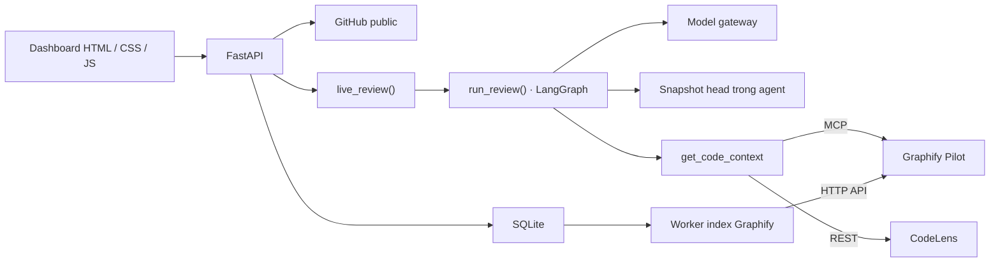

# Code Review Agent Core

Agent review code độc lập dùng Python và LangGraph. Dashboard FastAPI nhận mã nguồn từ GitHub public hoặc ZIP, ghim hai snapshot base/head, rồi chạy review với ngữ cảnh từ CodeLens hoặc Graphify. SQLite lưu repo, snapshot, phiên chat, kết quả và cấu hình kết nối. CLI có sẵn ca demo liên file chạy bằng fixture.

## Chạy local

Trong thư mục chứa `pyproject.toml` của app, tạo môi trường Python riêng và cài package.

```bash
python3.12 -m venv .venv
.venv/bin/python -m pip install .
.venv/bin/review-agent demo
.venv/bin/python -m unittest discover -s tests -v
```

Demo dự kiến trả JSON với `status: complete`, ba lượt model, hai lượt tool và một finding tại `reports/monthly.py:5`. Model trong demo được viết theo kịch bản. Kết quả này kiểm tra cơ chế của graph trước khi đo chất lượng review với model thật.

## Kiến trúc



`review-agent serve` đi qua `cli.main()` → `dashboard.serve()` → `create_app()`. FastAPI mở SQLite, nạp cấu hình, phục vụ dashboard và chạy worker index Graphify theo vòng đời ứng dụng. Các API chuẩn bị snapshot và phiên trước khi chuyển một lượt review cho core. [CLI](cli.py#L10) · [Khởi tạo FastAPI](dashboard.py#L101)

| Thành phần | Trách nhiệm |
|---|---|
| [`static/app.js`](static/app.js) | Quản lý giao diện repo và chat, gửi yêu cầu review, theo dõi index và hiển thị kết quả. |
| [`dashboard.py`](dashboard.py) | Các API repo, snapshot, diff, phiên chat và review. `execute_review()` ghép đầu vào và lưu kết quả. |
| [`dashboard_sources.py`](dashboard_sources.py) | Tải snapshot GitHub, đọc ZIP, tạo gói source cho Graphify và tính diff từ nội dung file. |
| [`graph.py`](graph.py) | Schema, vòng lặp LangGraph, giới hạn tool và kiểm chứng bằng chứng. |
| [`dashboard_providers.py`](dashboard_providers.py) | Adapter model gateway, CodeLens REST và Graphify MCP. |
| [`dashboard_graphify.py`](dashboard_graphify.py) | Hàng đợi tạo index, theo dõi project Pilot và lấy token MCP cho snapshot. |
| [`dashboard_store.py`](dashboard_store.py) · [`dashboard_settings.py`](dashboard_settings.py) | Schema SQLite, truy vấn dữ liệu và cấu hình kết nối. |

## Luồng từ repo đến kết quả

1. **Nhập source.** `create_project()` tải ZIP của GitHub tại SHA đã phân giải từ branch, tag hoặc commit. Với repo ZIP, `upload()` gọi `read_archive()` để đọc và lọc file. ZIP từ `git archive` giữ SHA trong metadata. ZIP thường dùng dấu vân tay nội dung. Agent giữ nội dung text dùng cho review và gói source đã lọc để gửi Pilot. [Tạo repo](dashboard.py#L265) · [API upload](dashboard.py#L319) · [Chuẩn hóa snapshot](dashboard_sources.py#L34)
2. **Chọn base và head.** `commit_history()` lấy metadata GitHub theo trang, còn `snapshot_for_github_ref()` tải hoặc dùng lại snapshot được chọn theo SHA. `snapshot_diff()` so nội dung file giữa base và head để tạo unified diff và danh sách file thay đổi. Giới hạn hiện tại là 20 MiB cho ZIP, 60 MiB sau giải nén và 40.000 ký tự diff cho một phiên, tính cả repo liên quan. [Lịch sử commit](dashboard.py#L304) · [Dùng lại snapshot](dashboard.py#L167) · [Tạo diff](dashboard_sources.py#L162)
3. **Ghim phạm vi.** `create_session()` lưu repo chính, cặp snapshot và provider, cùng tối đa bốn repo liên quan. Mỗi repo liên quan có head riêng để đọc và truy vấn. Chọn thêm base nếu muốn đưa diff của repo đó vào lượt review. `session_scope()` ánh xạ mỗi repo thành khóa `primary` hoặc `repo_<id>` và chuẩn bị index Graphify khi cần. [Tạo phiên](dashboard.py#L370) · [Phạm vi phiên](dashboard.py#L205)
4. **Chạy review.** `runReview()` trên UI gửi lượt chat tới `session_turn()`. `execute_review()` đọc snapshot đã ghim, dựng `ReviewInput`, chọn kết nối và gọi `live_review()`. Chế độ **So sánh hai provider** chạy hai lượt tuần tự với cùng diff, source, model và ngân sách tool. Mỗi lượt có trace và kết quả riêng. [Điểm vào từ UI](static/app.js#L523) · [Điều phối review](dashboard.py#L420)
5. **Lưu và hiển thị.** `Store.add_review()` lưu findings, gaps, SHA, phạm vi repo và trace. `renderReview()` hiển thị kết quả, và người dùng có thể mở lại lịch sử hoặc tải JSON. [Lưu kết quả](dashboard_store.py#L240) · [Hiển thị review](static/app.js#L298)

## Core agent và vòng lặp LangGraph

`run_review()` nhận một `ReviewInput` gồm base/head SHA, diff, yêu cầu của người dùng, ngữ cảnh lượt trước nếu có và danh sách repo liên quan. `live_review()` truyền vào các hàm gọi model, đọc file, tìm source và truy vấn graph. Core dùng các hàm này theo hợp đồng chung. `run_demo()` gắn các hàm giả lập vào cùng core để thử vòng lặp trên một ca đổi chữ ký hàm nhưng bỏ sót caller ngoài diff. [Kiểu dữ liệu và callback](graph.py#L57) · [Khởi tạo adapter](dashboard_providers.py#L239) · [Demo](demo.py#L35)

1. **`reviewer()` gọi model.** Lượt đầu gửi diff, SHA, phạm vi và schema tool. Core kiểm tra ngân sách trước khi thực thi yêu cầu tool. Mặc định mỗi review có tối đa **6 lượt model và 8 lượt tool**. Nếu cả nhóm tool vượt ngân sách hoặc đã hết lượt model để xử lý kết quả, review dừng với `review_budget_exhausted`. [Node reviewer](graph.py#L158)
2. **`call_tools()` thực thi yêu cầu.** Core kiểm tra tên tool, tham số, đường dẫn tương đối và repo thuộc phạm vi phiên. Các lời gọi chạy tuần tự và kết quả được gắn lại với đúng `tool_call_id` trước khi quay về `reviewer()`. [Node call_tools](graph.py#L197)
3. **Core kiểm chứng findings.** Khi model dừng, `ReviewOutput` kiểm tra JSON. Mỗi finding phải có đoạn trích xuất hiện trên đúng dòng đã được trả bởi `read_file`. Bằng chứng được giữ theo repo, đường dẫn và số dòng. Finding có đoạn trích lệch bị loại và ghi `unverified_quote`. Bước này xác nhận vị trí và đoạn trích. Nhận định về lỗi vẫn dựa trên phân tích của model. [Kiểm chứng output](graph.py#L175)

| Tool | Hành vi |
|---|---|
| `get_code_context` | Lấy gợi ý về caller, callee hoặc file liên quan qua provider đã chọn. |
| `read_file` | Đọc tối đa 120 dòng từ snapshot head đã ghim và đưa số dòng vào tập bằng chứng. |
| `search_code` | Tìm chuỗi trong snapshot đã ghim, tối đa 12 kết quả. Tool này có trong phiên liên repo. |

`next_step()` quay lại vòng tool khi còn yêu cầu hợp lệ, rồi kết thúc khi có output cuối hoặc gặp lỗi. `complete` nghĩa là lượt review kết thúc mà không ghi gap. `incomplete` có thể đi cùng findings đã kiểm chứng. Xem trace `get_code_context` để xác nhận review có truy vấn graph. [Chuyển trạng thái và kết quả](graph.py#L253)

## Kết nối bên ngoài

| Kết nối | Dữ liệu và xác thực |
|---|---|
| **GitHub public** | Backend đọc metadata commit và tải ZIP tại SHA đã ghim. Việc chọn commit nằm ở tầng dashboard. [API snapshot GitHub](dashboard_sources.py#L117) |
| **Model gateway** | `GatewayReviewer` dùng Chat Completions tương thích OpenAI và API key cấu hình ở backend. Gateway nhận diff và hội thoại trong lượt review, gồm các đoạn source và ngữ cảnh graph được trả về khi gọi tool. [Adapter model](dashboard_providers.py#L162) |
| **CodeLens REST** | `CodeLensLookup` gửi project ID, branch và đường dẫn file tới `POST /context/` bằng token REST. Với branch ID, adapter kiểm tra `ready` và `head_sha` trước và sau truy vấn. CodeLens chịu trách nhiệm tạo index branch. [Adapter CodeLens](dashboard_providers.py#L70) |
| **Graphify Pilot HTTP** | `PilotIndexer` dùng tài khoản Pilot để gửi ZIP head, theo dõi trạng thái và lấy token MCP. Agent lưu liên kết theo snapshot và tái sử dụng project khi review lại cùng head. [Worker index](dashboard_graphify.py#L78) |
| **Graphify MCP** | `graphify_lookup()` khởi tạo phiên Streamable HTTP với Bearer token của project rồi gọi `query_graph`. Model chọn repo và file. Adapter chọn URL, token, MCP tool và tham số truy vấn. [Adapter MCP](dashboard_providers.py#L124) |

`_context_result()` loại ngữ cảnh khi SHA index lệch head. Khi thiếu SHA, agent trả ngữ cảnh dưới dạng gợi ý chưa xác minh và ghi gap. Với Graphify, trace phân biệt SHA do provider trả, SHA theo snapshot do agent upload và SHA do người vận hành khai báo. [Đối chiếu SHA](dashboard_providers.py#L60) · [Gắn snapshot với MCP project](dashboard_graphify.py#L41)

## Lưu trữ và theo dõi

Dashboard mặc định dùng `review-data/reviews.sqlite3`. `Store` tạo hoặc nâng cấp schema khi khởi động, bật khóa ngoại và đặt quyền file `0600`. Graphify và CodeLens giữ index trong kho dữ liệu của dịch vụ tương ứng. [Schema SQLite](dashboard_store.py#L18)

| Bảng | Dữ liệu lưu |
|---|---|
| `projects` | Repo, nguồn nhập, ref theo dõi, provider mặc định và liên kết CodeLens. |
| `snapshots` | Revision, nguồn gốc, nội dung file text và ZIP đã lọc. Revision là duy nhất trong từng repo. |
| `review_sessions` | Tên phiên, provider, base/head và danh sách repo liên quan. |
| `reviews` | Kết quả từng lượt, provider, thời điểm chạy và phiên liên quan nếu có. |
| `provider_settings` | Cấu hình chung, gồm URL, model và thông tin xác thực. Backend giữ giá trị secret và API chỉ trả trạng thái đã cấu hình. |
| `graphify_indexes` | Trạng thái job, project ID, token MCP và hạn token theo snapshot và tài khoản Pilot. |

- **Trace và chi phí.** Mỗi bước tool ghi tên tool, file hoặc truy vấn, trạng thái, lý do lỗi và SHA khi có. Trace ghi thêm repo trong phiên liên repo và nguồn SHA cho kết quả graph. Dashboard hiển thị số lượt model/tool, thời gian chạy, tổng token khi gateway trả usage đầy đủ và số bước truy vấn graph khớp SHA. `graph_calls` đếm các bước `get_code_context` trong core. Số request mạng thực tế và chi phí bằng tiền nằm ngoài các số liệu hiện có. [Ghi trace](graph.py#L236) · [Tổng hợp số liệu](dashboard_providers.py#L272)
- **Ngữ cảnh hỏi tiếp.** `follow_up_to` đưa yêu cầu, findings và gaps của một lượt trước vào đầu vào mới, với điều kiện cùng phiên, provider và base/head. LangGraph khởi tạo state mới cho từng lượt. Bộ nhớ học từ phản hồi qua nhiều phiên và báo cáo tuần là hướng phát triển tiếp. [Nạp ngữ cảnh lượt trước](dashboard.py#L430) · [Khởi tạo state](graph.py#L262)
- **Kiểm thử.** Ca demo kiểm tra vòng lặp liên file bằng fixture. Bộ test bao phủ ngân sách, kiểm chứng quote, định tuyến repo, ghim snapshot, cấu hình kết nối và hợp đồng adapter. [Test core](tests/test_core.py) · [Test dashboard](tests/test_dashboard.py)

## Chạy trên server

Khi clone app từ GitHub lên server, chạy trong thư mục có `Dockerfile`.

```bash
docker build -t code-review-agent-core .
docker run --rm --network none code-review-agent-core demo
```

Container chạy lệnh và thoát sau khi in JSON. Ca demo chạy độc lập, nên server có thể kiểm tra image trước khi cấu hình endpoint hoặc credentials cho các provider thật.

## Dashboard

```bash
.venv/bin/python -m pip install '.[web]'
.venv/bin/review-agent serve --port 8765
```

Mở `http://127.0.0.1:8765`. Chọn **Pricing demo** và bấm **Chạy review** để kiểm tra giao diện bằng fixture. SQLite lưu snapshot và lịch sử tại `review-data/reviews.sqlite3`.

- **GitHub public** nhận `owner/repo`, head ref và base ref tùy chọn. **Kiểm tra thay đổi** lấy commit mới trên branch và lưu snapshot để review. Có thể thử chính `thanhphu25/code-review-agent-core` với base `df68d5b` và head `d76a276`.
- **ZIP** nhận snapshot base và head. Dùng `git archive --format=zip -o head.zip HEAD` để giữ SHA trong ZIP. ZIP thông thường dùng dấu vân tay nội dung. Agent lưu file text để review và giữ gói source đã lọc để gửi Graphify. Mục **File nguồn** dùng snapshot head đã ghim khi mở phiên, hoặc snapshot mới nhất trong trang repo.
- **Kết quả** hiển thị finding kèm quote, trace tool, token nếu gateway cung cấp và thời gian chạy. Chọn mục lịch sử để mở lại run.

Workspace mở theo từng repository. Dùng **Chat mới** để đặt tên phiên, chọn mode **Graphify** hoặc **CodeLens** và ghim base/head. Gửi yêu cầu trực tiếp trong **Review nhanh / so sánh** cũng tạo phiên cho cặp đang chọn. Các phiên có lịch sử riêng và mở lại từ sidebar hoặc URL. Muốn đổi provider hay snapshot, tạo phiên khác. **So sánh hai provider** nằm trong **Review nhanh / so sánh** và chạy hai lượt độc lập với cùng yêu cầu.

- Với GitHub public, bấm **Chọn commit GitHub** để xem lịch sử của ref đang theo dõi. Dashboard gợi ý head mới nhất đã kiểm tra và commit cha thứ nhất làm base. Có thể đổi cả hai hoặc tải thêm commit cũ. Dùng **Nhập commit hoặc ref GitHub** để so với SHA, tag hoặc branch ngoài danh sách. Agent tải snapshot cho cặp đã chọn và giữ nguyên ref theo dõi. Với ZIP, dùng **Thêm ZIP** để nhập các phiên bản cần so sánh.
- Trong hộp **Chat mới**, gắn tối đa bốn repo đã nhập. Chọn head để agent đọc ngữ cảnh. Chọn thêm base nếu muốn đưa diff của repo đó vào lượt review.
- Repo liên quan dùng snapshot và index của chính nó. Với Graphify Pilot tự động, agent đưa các head đã ghim vào hàng đợi. Với CodeLens, cấu hình liên kết project/branch cho từng repo cần truy vấn. Agent có thể đọc và tìm trong snapshot liên quan khi graph của repo đó chưa sẵn sàng. Trace ghi lý do nếu một lần truy vấn graph thiếu index.
- Finding và trace liên repo ghi repo cùng SHA đã dùng để kiểm chứng. **Xem diff** nằm ở snapshot repo chính và dưới từng repo liên quan có base. Lịch sử các lượt cũ và so sánh nằm trong **Review nhanh / so sánh**.

Đặt `REVIEW_DASHBOARD_PASSWORD` để bật đăng nhập bằng user `review` và mở mục **Kết nối**. Mật khẩu là bắt buộc khi bind ngoài loopback. Cấu hình URL và key của model, Graphify hoặc CodeLens áp dụng từ lượt review tiếp theo và được lưu trong SQLite. Để trống ô key để giữ giá trị hoặc dùng hộp chọn để xóa. Cấu hình đã lưu có ưu tiên hơn biến môi trường.

Nếu Graphify Pilot và agent chạy trực tiếp trên cùng máy, có thể dùng chung port trên hai địa chỉ khác nhau. Bind Graphify vào `127.0.0.1:18081` với origin `http://127.0.0.1:18081`, và bind agent vào đúng IP LAN của máy, ví dụ `review-agent serve --host 192.168.1.10 --port 18081`. Để tự động index, nhập URL gốc `http://127.0.0.1:18081` trong **Graphify Pilot · tự động index**. Với **MCP thủ công**, dùng URL dạng `http://127.0.0.1:18081/mcp/PROJECT_ID`. Dùng HTTPS hoặc SSH tunnel khi nhập key qua trình duyệt.

```bash
docker build -t code-review-agent-core .
docker run --rm -p 127.0.0.1:8765:8765 --env-file /path/to/review.env \
  -v review-agent-data:/data code-review-agent-core \
  serve --host 0.0.0.0 --port 8765 --database /data/reviews.sqlite3
```

### CodeLens trước

| Biến | Giá trị |
|---|---|
| `REVIEW_AGENT_LLM_BASE_URL` | URL LiteLLM/OpenAI-compatible |
| `REVIEW_AGENT_LLM_API_KEY` | Key của gateway |
| `REVIEW_AGENT_LLM_MODEL` | Model alias hỗ trợ tool calling |
| `CODELENS_API_BASE` | REST base như `https://codelens.example/api/v1/rag` |
| `CODELENS_API_TOKEN` | Token REST của CodeLens |

Các biến trong bảng dùng làm mặc định. Ba biến `CODEDECK_AGENT_LLM_*` của bản thử trước cũng dùng được nếu đã cấu hình.

Sau khi CodeLens index branch, mở **Cấu hình CodeLens**, nhập GitLab project ID và branch. Nếu REST context không trả `indexed_sha`, nhập thêm CodeLens branch ID để dashboard so `head_sha` của index trước và sau truy vấn. SHA lệch trả gap và loại dữ liệu đó. Khi thiếu SHA, dữ liệu chỉ làm gợi ý và kết quả ghi `incomplete`.

### Graphify và so sánh

Trong **Kết nối → Graphify Pilot · tự động index**, nhập URL gốc của Pilot (ví dụ `http://127.0.0.1:18081`), tài khoản Pilot và mật khẩu. Ba giá trị này cũng có thể cấu hình qua `GRAPHIFY_PILOT_URL`, `GRAPHIFY_PILOT_USER` và `GRAPHIFY_PILOT_PASSWORD`. Dùng tài khoản Pilot riêng cho agent vì mỗi project trên Pilot chỉ có một token MCP đang hoạt động.

- Chọn **Graphify** khi thêm repo. Với ZIP, có thể nhập base và head cùng lúc. Agent chuyển toàn bộ cây source của head đã nhập sang Pilot. Với GitHub public, agent lấy ZIP theo SHA của head và thực hiện cùng luồng. Thêm một snapshot với vai trò **Base** để giữ nó trong SQLite mà không gửi index lúc upload.
- Agent theo dõi job của Pilot và tự cấp token MCP khi project sẵn sàng. Mỗi snapshot giữ liên kết Graphify riêng trong SQLite, nên có thể mở lại repo sau khi restart. Trace ghi `graphify_agent_upload` khi SHA được đối chiếu theo snapshot agent đã gửi.
- Với snapshot cũ, agent dựng lại ZIP từ các file text còn trong SQLite. Nhập lại bản ZIP nguồn nếu cần index phần source mà snapshot cũ đã bỏ qua. Số project vẫn theo giới hạn của tài khoản Pilot.
- Để dùng MCP cấu hình sẵn, dùng phần **Graphify · MCP thủ công** và để trống kết nối tự động của Pilot. Có thể dùng `GRAPHIFY_MCP_URL`, `GRAPHIFY_API_KEY` và `GRAPHIFY_INDEXED_SHA` làm mặc định. Trường **SHA đã index** được dùng khi phản hồi MCP thiếu revision.

Chọn cùng base/head và bấm **So sánh hai provider**. Hai run nhận cùng diff, source, model và ngân sách tool. Dashboard đặt findings, thời gian, token và số lần truy vấn khớp SHA cạnh nhau. Có thể gọi riêng từng provider trong cùng workspace.

### Ca benchmark có nhãn

- [AACR-Bench](https://github.com/alibaba/aacr-bench) phù hợp để chọn PR mà finding cần ngữ cảnh liên file. Phương pháp chấm và nhãn nằm trong [bài nghiên cứu](https://arxiv.org/abs/2601.19494).
- [ReviewBench](https://github.com/review-bench/ReviewBench) công bố bộ test 25 PR, nhãn human-reviewed và mirror chứa commit base/head. Có thể nhập mirror và hai SHA trực tiếp vào dashboard.

Ca Python `AA-Factory/aafactory-prototype#17` đã được kiểm tra tải qua GitHub và dựng diff trong giới hạn dashboard. Dùng các giá trị từ [manifest ReviewBench](https://github.com/review-bench/ReviewBench/blob/main/corpus/test/test.json).

| Trường | Giá trị |
|---|---|
| GitHub owner/repo | `review-bench/AA-Factory_aafactory-prototype` |
| Base ref | `e7f558c7360abac335af2df22f4ed376992b30ab` |
| Head ref | `a1978cb75950a879df8805e4a5f373eb6678f6f9` |

Index đúng head ở cả CodeLens và Graphify rồi chọn hai provider. Giữ [golden findings](https://github.com/review-bench/ReviewBench/blob/main/corpus/test/findings.json) riêng để chấm sau khi review.

Ghim danh sách case, alias model, snapshot của hai graph và giới hạn lượt trước khi chạy. So findings với golden labels bằng root cause và vị trí, rồi ghi precision, recall và F1. Dashboard hiện lưu kết quả và số đo vận hành cho từng ca. Việc chấm theo golden labels dùng rubric của bộ benchmark đã chọn.
